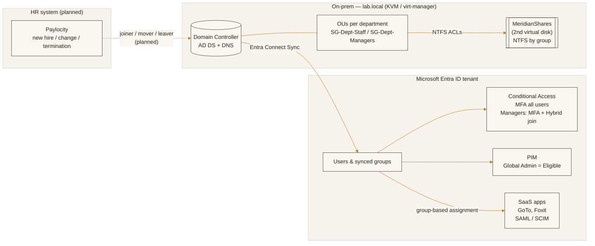
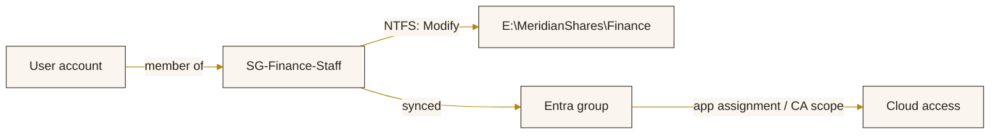
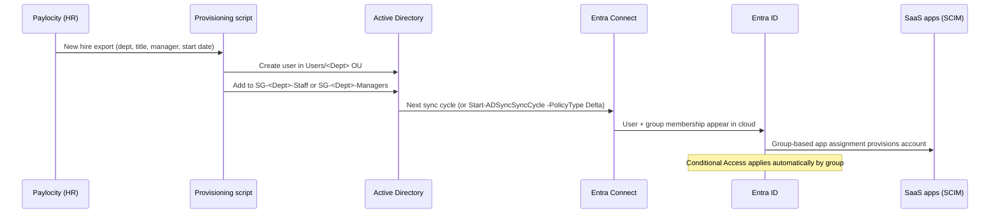

# 

<p>
  
  
  
  
  
</p>

This is a hands-on identity and access management (IAM) project. It runs in a **hybrid Active Directory / Microsoft Entra ID lab** and is built around a fictional 50-person structural steel company. Every access decision comes from how that business is organized: who needs what, at what level and why.

> [!NOTE]
> **Background:** I built this to work through a problem from my day-to-day MSP work. It runs on a separate tenant with a fictional company name, so the full design can be public without exposing any client data.

> **In one sentence:** I designed department- and tier-based RBAC in on-prem AD, enforced it on NTFS file shares, synced identities to Entra ID, and added Conditional Access and PIM on top. The next phase automates joiner/mover/leaver events from HR.

<p align="center"></p>

## Contents

1. [Scenario](#-1-scenario)
2. [Architecture](#-2-architecture)
3. [Lab environment](#-3-lab-environment)
4. [Access model](#-4-access-model)
5. [File share infrastructure](#-5-file-share-infrastructure)
6. [Identity security layer](#-6-identity-security-layer)
7. [Identity lifecycle automation (JML)](#-7-identity-lifecycle-automation-jml)
8. [Validation & evidence](#-8-validation--evidence)
9. [Design decisions & trade-offs](#-9-design-decisions--trade-offs)
10. [Hardening backlog](#-10-hardening-backlog)
11. [Roadmap](#-11-roadmap)
12. [Lessons learned](#-12-lessons-learned)
13. [Skills demonstrated](#-13-skills-demonstrated)
14. [Repository layout](#-14-repository-layout)

<p align="center"></p>

## 🏭 1. Scenario

**Meridian Steel & Fabrication** is a fictional structural steel fabrication and construction company with about 50 employees. I treated it like a real client engagement. Organizations rarely need "generic" AD structure. They need access that matches how the business actually works.

| Department | Typical data | Why access is separated |
|---|---|---|
| Executive | Strategy, M&A, board material | Highest sensitivity |
| Finance / Accounting | AP/AR, payroll exports, bank records | Financial controls, fraud prevention |
| HR | Personnel files, reviews, benefits | PII, legal exposure |
| Project Management / Estimating | Bids, cost estimates, schedules | Competitive bid data |
| Engineering / Drafting | Shop drawings, CAD, calcs | IP; drawing revision control |
| Shop / Fabrication | Cut lists, work orders | Needs drawings (read), not financials |
| Field / Site Supervisors | Daily logs, site photos, RFIs | Mobile/off-site sign-ins |
| IT / Admin | Infrastructure, credentials | Privileged; tiered admin |
| Sales / Business Development | CRM exports, proposals | Customer data |

## 🧱 2. Architecture



**Source of authority:** on-prem AD is the source of authority for users and groups. Entra ID gets them through sync, so the NTFS permission chain and cloud access use the same group objects.

## 💻 3. Lab environment

| Component | Detail |
|---|---|
| Hypervisor | KVM / virt-manager |
| Domain | `lab.local`, single forest, single domain |
| Domain Controller | AD DS, DNS, and the department file shares |
| Storage | Second virtual disk on the DC, formatted and mounted as a dedicated data drive |
| Sync | Azure AD Connect (now *Microsoft Entra Connect Sync*) |
| Cloud | Microsoft Entra ID tenant with Conditional Access and PIM (Entra ID P2 features) |

<p align="center"></p>

## 🔑 4. Access model

### 4.1 OU structure

```
lab.local
└── Meridian
    ├── Users
    │   ├── Executive
    │   ├── Finance
    │   ├── HR
    │   ├── ProjectMgmt
    │   ├── Engineering
    │   ├── Shop
    │   ├── Field
    │   ├── IT
    │   └── Sales
    ├── Groups            ← all SG-* security groups
    ├── Computers
    ├── Service Accounts
    ├── Admin Accounts    ← separate admin identities (never daily-driver accounts)
    └── Disabled Users    ← leavers land here (see JML)
```

### 4.2 Group naming convention

`SG-<Department>-<Tier>`, with a few cross-department roll-up groups.

| Pattern | Example | Purpose |
|---|---|---|
| `SG-<Dept>-Staff` | `SG-Finance-Staff` | Day-to-day users in a department |
| `SG-<Dept>-Managers` | `SG-Finance-Managers` | Department leadership |
| `SG-AllManagers` | — | Holds every `*-Managers` group. Conditional Access scopes to this group |

All groups are **Global security groups**, created **on-prem** and synced to Entra.

### 4.3 Access matrix — department shares

Each department's folder is open only to that department. Inside the department, **staff and managers get different rights**.

| Share folder | `SG-<Dept>-Staff` | `SG-<Dept>-Managers` | Everyone else |
|---|---|---|---|
| `\Executive` | Modify | Full Control | No access (folder hidden by ABE) |
| `\Finance` | Modify | Full Control | No access |
| `\HR` | Modify | Full Control | No access |
| `\ProjectMgmt` | Modify | Full Control | No access |
| `\Engineering` | Modify | Full Control | No access |
| `\Shop` | Modify | Full Control | No access |
| `\Field` | Modify | Full Control | No access |
| `\IT` | Modify | Full Control | No access |
| `\Sales` | Modify | Full Control | No access |

`SYSTEM` and `BUILTIN\Administrators` keep Full Control on every folder.

> Cross-department needs, such as Shop reading Engineering's released drawings, are good candidates for **purpose-specific groups** like `SG-Engineering-Drawings-Read`. That's better than adding Shop users to `SG-Engineering-Staff`. See the [hardening backlog](#-10-hardening-backlog).

### 4.4 Permission flow



**Access goes to groups, never directly to users.** Changing someone's access means changing their group membership. That one change applies on-prem and in the cloud.

## 📁 5. File share infrastructure

I built the department shares from scratch on the DC so I controlled the whole permission chain myself:

1. Added a **second virtual disk** to the DC VM in virt-manager.
2. Brought it online, initialized it, formatted it NTFS and mounted it as a dedicated data drive.
3. Created the `MeridianShares` root with one subfolder per department.
4. **Turned off inheritance** on each department folder and applied explicit ACLs from the access matrix.
5. Published the root as an SMB share. The share permissions stay broad and **NTFS does the real enforcement**, which is the standard Microsoft pattern. **Access-Based Enumeration** hides folders a user can't open.

`scripts/03-Set-MeridianSharePermissions.ps1` repeats steps 3–5 the same way every time.

<p align="center"></p>

## 🔐 6. Identity security layer

### 6.1 Conditional Access

| Policy | Users | Excluded | Grant controls | Rollout |
|---|---|---|---|---|
| **Require MFA – All Users** | All users | Break-glass account | Require MFA | **Report-only** first; I checked sign-in logs, then turned it on |
| **Managers – MFA + Hybrid Join** | `SG-AllManagers` | Break-glass account | Require MFA **and** a Microsoft Entra hybrid joined device | Report-only first, then turned on |

**Why report-only first:** in report-only mode, Entra logs what each policy *would* have done for every sign-in. Reviewing that before enforcing means nobody gets locked out by surprise, including the admin.

### 6.2 Privileged Identity Management

| Account | Role | Assignment | Reason |
|---|---|---|---|
| Sync / admin account | Global Administrator | **Eligible** (activate just-in-time) | No standing privilege for daily admin work |
| Break-glass account | Global Administrator | Permanent **Active** | Emergency access if MFA, PIM or federation fails |
| Personal admin account | Global Administrator | Permanent **Active** | Lab owner recovery path (would be moved to Eligible in production) |

## 🔄 7. Identity lifecycle automation (JML)

The goal: **access follows HR events, not manual tickets.**



| Event | Action | Script |
|---|---|---|
| **Joiner** | Create the user in the correct OU, set attributes and manager, add to the department/tier group | `04-New-MeridianUsersFromCsv.ps1` |
| **Mover** | Swap department/tier groups. Old access is **removed**, not just added on top | Planned |
| **Leaver** | Disable the account, record and strip group memberships, move to `Disabled Users`. Sync then blocks cloud sign-in and SaaS deprovisions | `05-Disable-MeridianUser.ps1` |

<p align="center"></p>

## ✅ 8. Validation & evidence

| # | Test | Expected result | How verified |
|---|---|---|---|
| 1 | Finance staff user opens `\Finance` | Read/write works; can't change permissions | Effective Access tab / test sign-in |
| 2 | Finance staff user browses `\\DC\MeridianShares` | Only `Finance` is visible (ABE) | Test sign-in |
| 3 | Shop user tries a `\HR` UNC path directly | Access denied | Test sign-in |
| 4 | New user signs in to Entra | MFA prompt | Sign-in logs → Conditional Access tab |
| 5 | Manager signs in from a non-hybrid-joined device | Blocked | Sign-in logs / What If tool |
| 6 | Break-glass account signs in | Not subject to CA policies | Sign-in logs |
| 7 | Admin needs Global Admin | Must activate the role in PIM first | PIM → My roles → Activate |
| 8 | Group change on-prem | Shows up in Entra after delta sync | Entra group membership |

`scripts/06-Get-MeridianAccessReport.ps1` exports every group's members and every folder's ACL to CSV. That's the evidence for an **access review**.

Screenshots: see [`docs/screenshots/`](docs/screenshots/).

## 🧠 9. Design decisions & trade-offs

| Decision | Why | Trade-off / what I'd change at scale |
|---|---|---|
| **AGDLP's Domain Local layer was dropped**; Global groups go straight on ACLs | Single domain, so Domain Local groups add a layer with no benefit | With multiple domains or forests, I'd bring back AGDLP so access can cross trusts |
| **Groups and OUs are created on-prem**, not in the cloud | The NTFS chain lives on-prem, and cloud-created groups don't sync down to AD by default | Entra Cloud Sync can now provision cloud security groups to AD. Worth looking at for a cloud-first design |
| **Shares hosted on the DC** | Lab simplicity and full control of the permission chain | In production, file services belong on a separate member server (or Azure Files). DCs should stay single-purpose Tier 0 |
| **Staff = Modify, Managers = Full Control** | Mirrors real authority differences inside a department | Full Control lets a manager change ACLs and take ownership. See the hardening backlog |
| **Report-only before enforcing CA** | Avoids lockouts, and real sign-in data backs each decision | — |
| **Break-glass excluded from all CA** | Recovery path if MFA or CA is misconfigured | Must be monitored (alert on every sign-in) and have a long, vaulted credential |

<p align="center"></p>

## 🔒 10. Hardening backlog

These are improvements I identified while reviewing the build. Each one is a production-grade next step.

- [ ] **Managers → Modify + a separate owner group.** Full Control lets non-IT users rewrite ACLs. Use Modify for managers and give Full Control only to an IT-managed group such as `SG-FileShare-Admins`.
- [ ] **Second break-glass account**, plus an alert on any break-glass sign-in (Log Analytics / Azure Monitor alert rule)
- [ ] **Block legacy authentication** CA policy. Legacy protocols can't do MFA.
- [ ] **PIM activation settings:** require MFA, a justification and approval for Global Admin, with a max activation of 1–2 hours
- [ ] **Least-privilege admin roles:** move day-to-day admin to User Administrator, Groups Administrator, etc. instead of Global Admin
- [ ] **Access reviews** (Entra ID Governance) on the `*-Managers` groups and privileged roles each quarter
- [ ] **Purpose-specific cross-department groups**, e.g. `SG-Engineering-Drawings-Read` for Shop and Field
- [ ] **Tiered admin model:** separate `adm-` accounts for Tier 0 (DC) work, with no email or browsing
- [ ] **Audit file access:** enable Object Access auditing on sensitive shares (HR, Finance, Executive)
- [ ] **Move file shares off the DC** to a member server or Azure Files with identity-based auth

## 🧭 11. Roadmap

- [x] Department/tier RBAC model and naming convention
- [x] On-prem OUs and Global security groups
- [x] Second disk and department file shares with NTFS permissions
- [x] Hybrid sync to Entra ID
- [x] Conditional Access: MFA for all users (report-only → enforced)
- [x] Conditional Access: manager tier MFA + hybrid join
- [x] PIM: Global Admin moved to Eligible for the admin account
- [x] SaaS SAML/SCIM configuration validated on the Entra side (GoTo, Foxit)
- [ ] HR-driven onboarding (Paylocity → AD → Entra → groups)
- [ ] Mover workflow (department change = remove old access + add new)
- [ ] End-to-end SCIM provisioning test (blocked by SaaS paid-tier licensing)
- [ ] Items from the [hardening backlog](#-10-hardening-backlog)

## 💡 12. Lessons learned

- **Model the business first, then build AD.** The department/tier matrix made every group, folder and policy decision simple.
- **Where an object is created decides where it can be used.** Cloud-created groups can't be used in on-prem NTFS ACLs without extra tooling, so the source of authority has to be decided early.
- **Report-only mode is worth it.** It turns "I hope this doesn't lock anyone out" into "the logs show who this affects."
- **Licensing is part of the architecture.** The Entra-side SCIM configuration was correct. The blocker was the SaaS vendor's paid-tier gating. In a real project, that check belongs in the requirements phase.
- **Automate the "remove" side, not just the "add" side.** Most access creep comes from movers and leavers who keep old groups.

## 🎓 13. Skills demonstrated

| Area | Skills | Maps to |
|---|---|---|
| Identity design | RBAC, least privilege, OU/group design, naming standards | SC-300, AZ-104 |
| On-prem AD | AD DS, OUs, security groups, NTFS/SMB permissions, ABE | Windows Server administration |
| Hybrid identity | Entra Connect Sync, source of authority | SC-300, AZ-104 |
| Zero Trust controls | Conditional Access, MFA, device-based access, break-glass design | SC-300, SC-900 |
| Privileged access | PIM eligible vs. active assignments | SC-300 |
| Automation | PowerShell (ActiveDirectory module), CSV-driven provisioning, JML | AZ-104 |
| Governance | Access reviews, access reporting, audit evidence | SC-300 |
| Virtualization | KVM/virt-manager, virtual disk management | — |

## 📂 14. Repository layout

```
.
├── README.md                          ← this document
├── scripts/
│   ├── MeridianConfig.psd1            ← departments, domain, paths (single source of truth)
│   ├── 01-New-MeridianOUStructure.ps1
│   ├── 02-New-MeridianSecurityGroups.ps1
│   ├── 03-Set-MeridianSharePermissions.ps1
│   ├── 04-New-MeridianUsersFromCsv.ps1     ← joiner
│   ├── 05-Disable-MeridianUser.ps1         ← leaver
│   └── 06-Get-MeridianAccessReport.ps1     ← access review evidence
├── data/
│   └── sample-hr-export.csv           ← fake HR export for testing
└── docs/
    └── screenshots/                   ← evidence (see README inside)
```

Every script supports `-WhatIf`. Run with `-WhatIf` first, then for real. See [`scripts/README.md`](scripts/README.md).

<p align="center"></p>

## Tech / tools

Active Directory · Microsoft Entra ID · Microsoft Entra Connect Sync · Conditional Access · Privileged Identity Management · NTFS / SMB · PowerShell · KVM / virt-manager

📫 [LinkedIn](https://www.linkedin.com/in/joshua-richard-376140207)

<!-- pizzazz-recipe: {"pz":1,"kit":"my-color-profile","concept":"Spec Sheet","family":"refined","dev":{"intensity":"standard","flourish":"amber dividers","structure":"slim header"},"sig":"amber rule dividers","pal":{"pri":"#27241D","sec":"#423D33","tint":"#FAF5EE","zeb":"#F7F3EC","mut":"#625B50","ftr":"#6B6358","hair":"#D9D1C4","acc":"#D9A21B","watch":"#B44D12"},"font":{"h":"system-ui","b":"system-ui"},"date":"2026-11-18"} -->
